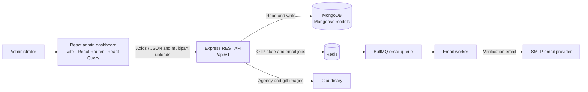

# Titto Live App Management

Titto Live App Management is an administration dashboard and REST API for operating core parts of the Titto Live platform. It brings user and agency oversight, coin sales, transaction and revenue reporting, gifts, salary targets, support agencies, and platform configuration into one web application.

## What problem it solves

Platform operations often span several separate tasks: reviewing users and agencies, changing commercial settings, recording coin sales, and checking financial activity. This project provides a shared web interface and backend API for managing those workflows and storing their operational data in MongoDB. It also moves verification-email delivery to a background queue so registration requests do not need to deliver mail inline.

## Current capabilities

- **Admin dashboard:** summary cards, tables, and operational views.
- **Accounts:** registration with email OTP verification, login, user listing, statistics, details, and deletion.
- **Agencies:** create and manage agencies, review status and bans, and upload agency documents/profile images.
- **Support agencies and countries:** maintain support-agency records and country references.
- **Coins and transactions:** configure exchange rates, sell coins to agencies, view transaction history and rates, and report monthly revenue.
- **Gifts and assets:** create, update, list, and delete gifts, including gift-image uploads and category totals.
- **Salary targets:** manage target and salary/share configurations.
- **Settings:** manage platform, user, currency, and commission configuration.
- **Admin UI:** dashboard pages for users, agencies, coin management, transactions, finance, salary targets, gifts/assets, support agencies, delete/ban review, and settings.

The delete/ban screen currently displays local sample data rather than live API records. The notification-center component is present in the frontend source, but its route is currently disabled.

## Architecture



### Request and registration flows

1. The dashboard sends requests through a shared Axios client to the API base URL.
2. Express mounts resource routers under `/api/v1`; controllers call service functions, which read and write Mongoose models.
3. During registration, the backend hashes the password, stores the OTP payload in Redis with a five-minute expiry, and enqueues an email job. The BullMQ worker sends the OTP using the configured mail transport. Valid OTP verification creates the account.
4. Agency documents, profile images, and gift images are uploaded to Cloudinary; their returned URLs are stored with MongoDB records.

## Technology

| Area | Technologies |
|---|---|
| Frontend | React 19, Vite 8, React Router, TanStack Query, Axios, Tailwind CSS, Recharts |
| Backend | Node.js, Express 5, Mongoose, Zod, JWT, bcrypt |
| Persistence and jobs | MongoDB, Redis, BullMQ |
| Integrations | Cloudinary image storage, Nodemailer/Gmail SMTP |

## Repository layout

```text
.
├── backend/
│   ├── config/          # MongoDB, Redis, Cloudinary, and mail configuration
│   ├── controllers/     # HTTP request/response handlers
│   ├── middlewares/     # Authentication, uploads, rate limits, and errors
│   ├── models/          # Mongoose schemas
│   ├── queue/           # BullMQ queues
│   ├── routes/          # Versioned API resource routers
│   ├── services/        # Business operations
│   ├── utils/           # Tokens, OTP, uploads, responses, and helpers
│   ├── validationSchema/# Zod request validation
│   └── workers/         # Email and dead-letter workers
└── frontend/
    └── src/
        ├── features/    # Feature-focused dashboard components and modals
        ├── layout/      # Shared admin shell
        ├── pages/       # Route-level screens
        ├── routes/      # Public and protected frontend routes
        ├── services/    # API calls
        └── shared/     # Reusable components, hooks, and utilities
```

## Getting started

### Prerequisites

- Node.js 22.12 or newer (or a newer compatible LTS release)
- npm
- MongoDB
- Redis
- Cloudinary credentials for image-upload workflows
- SMTP credentials for registration and OTP email delivery

MongoDB and Redis must be reachable by the backend. The backend starts an email worker and Redis-backed queues as part of its startup, so configure Redis even when only trying the API locally.

### Install dependencies

Run these commands from the repository root:

```bash
cd backend
npm install
cd ../frontend
npm install
```

### Configure environment

Create `backend/.env` with the following variables. Use your own local or hosted service credentials; do not commit real secrets.

```dotenv
PORT=5000
MONGO_URI=mongodb://127.0.0.1:27017/titto_live
JWT_SECRET=replace-with-a-long-random-secret
CLIENT_URL=http://localhost:5173

REDIS_HOST=127.0.0.1
REDIS_PORT=6379
REDIS_USERNAME=
REDIS_PASSWORD=

EMAIL_USER=your-smtp-account@example.com
EMAIL_PASS=your-smtp-app-password

CLOUDINARY_CLOUD_NAME=your-cloud-name
CLOUDINARY_API_KEY=your-api-key
CLOUDINARY_API_SECRET=your-api-secret
```

The mail transport is configured for Gmail; use an appropriate Gmail SMTP app password where required. `CLIENT_URL` should match the deployed frontend origin outside local development.

Create `frontend/.env`:

```dotenv
VITE_API_BASE_URL=http://localhost:5000/api/v1
```

`VITE_API_BASE_URL` is the API base path, including `/api/v1`; frontend service calls append resource paths such as `/auth/login` and `/settings`.

### Run locally

Start the backend in one terminal:

```bash
cd backend
npm start
```

Start the Vite frontend in another terminal:

```bash
cd frontend
npm run dev
```

Open the local URL printed by Vite (by default `http://localhost:5173`). The backend root health response is available at `http://localhost:5000/` when using the example `PORT`.

## Scripts

| Directory | Command | Purpose |
|---|---|---|
| `backend` | `npm start` | Run the API with Node watch mode |
| `frontend` | `npm run dev` | Start the Vite development server |
| `frontend` | `npm run build` | Create a production frontend bundle in `dist/` |
| `frontend` | `npm run preview` | Preview the production bundle locally |
| `frontend` | `npm run lint` | Run ESLint |

There is no root-level package script or automated test script currently defined.

## API areas

Resource endpoints use the `/api/v1` prefix; the backend also exposes a root health response at `/`.

| Resource | Route prefix | Purpose |
|---|---|---|
| Authentication | `/auth` | Registration, OTP verification/resend, and login |
| Settings | `/settings` | Read and save platform settings |
| Support agencies | `/support-agency` | Manage support agencies |
| Countries | `/country` | List and create countries |
| Salaries | `/salaries` | Manage salary-target records |
| Gifts | `/gifts` | Manage gifts, images, and category statistics |
| Users | `/users` | List users, statistics, details, and deletion |
| Agencies | `/agency` | Manage agencies and uploaded documents |
| Transactions | `/transactions` | Transaction rates/history and monthly revenue |
| Coins | `/coins` | Exchange rates and agency coin sales |

## Deployment notes

- Deploy the frontend and backend as separate services, and set `VITE_API_BASE_URL` to the deployed API origin plus `/api/v1`.
- Set backend environment variables through the hosting provider's secret/environment configuration. Provide production MongoDB, Redis, SMTP, and Cloudinary credentials as needed.
- Set `CLIENT_URL` to the frontend's production origin and confirm the API CORS configuration allows that origin.
- The frontend includes a Vercel rewrite for client-side route fallback. The API still needs its own deployment and service configuration.
- Keep secrets out of source control and use a strong, private `JWT_SECRET`.

## Important implementation notes

- The frontend protects dashboard routes by checking for an `adminToken` in browser local storage. This check alone does not establish an administrator role.
- Backend authorization is not consistently applied across management endpoints: only selected routes currently attach the JWT middleware, and the admin-role middleware is not wired into the route setup. Enforce and verify server-side authorization before exposing this API to production users.
- Some frontend areas are still demonstrative or incomplete; for example, the delete/ban screen uses local sample data rather than API-backed actions.
- `frontend/.env` and `backend/.env` are local configuration files, not shareable templates. Populate them with environment-specific values rather than copying credentials into documentation or commits.
